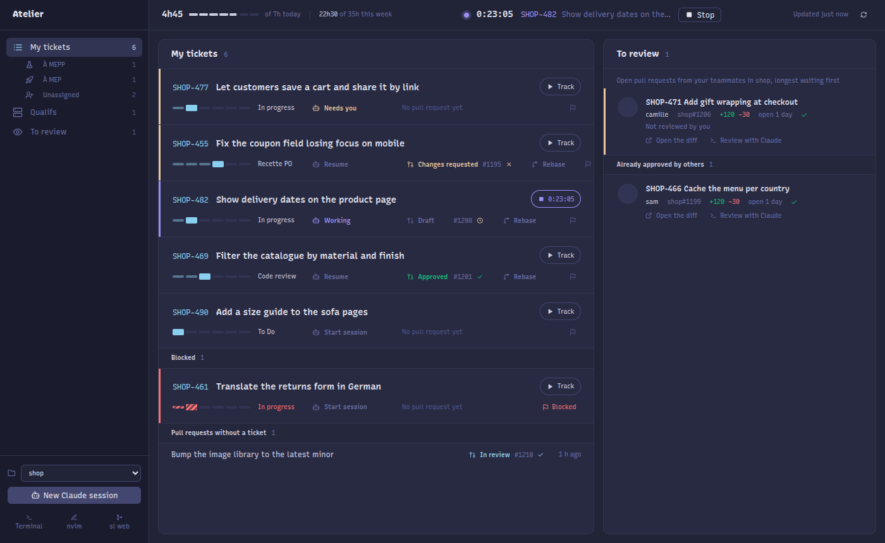

# Atelier

Atelier is the desktop app of the Tikamoon development team. It puts a developer's day-to-day work in one window: Jira tickets, Claude Code sessions, GitHub pull requests and reviews, qualif environments and time tracking.

Everyone runs their own copy, on their own machine, signed in with their own Jira and GitHub accounts. There is no server: Atelier calls Jira and GitHub with your credentials and keeps your settings and state in your home directory (see [Where Atelier keeps its files](#where-atelier-keeps-its-files)).

It runs on Linux. On Hyprland and Sway it can also switch to the windows of Claude sessions running outside it; on GNOME, KDE and other desktops it gets a normal title bar and cannot switch windows. Sapling is optional: without it `sl web` is unavailable and git is used.



## What it does

- **Tickets**: your Jira tickets, sorted by the columns of a board, with tabs for the columns you pick (MEPP and MEP, for example) and the unassigned tickets. Move a ticket between columns, flag it, take an unassigned one, log time against it with a timer, or add time by hand for a day you pick (`1h`, `1.5h`, `15m`, `1h 30m`). **My time entry** lists today's worklogs in chronological order, each with an **Edit** and an **Add time** button.
- **Claude sessions**: start or resume a Claude Code session on a ticket in an embedded terminal. Sessions already running in another terminal are shown too, and on Hyprland or Sway Atelier switches to their window.
- **Splits**: Ghostty-style panes inside a session. **Open nvim** puts nvim, or the [editor](#editor) you set, on the left of Claude, and extra shells split beside it. A pane closes when its program exits.
- **PRs and reviews**: GitHub PRs and their checks, rebase a ticket's PR, start a Claude review of a PR.
- **Qualifs**: which test environment holds which ticket, rebuild and deploy its branch, sync a Jira field, clear its cache. See [Qualifs](#qualifs).
- **Workflows**: start a Claude Code run from a button, follow its stages, answer its questions from Atelier and see its outcome and pull request. See [Workflows](#workflows).
- **Repo tools**: open Claude, a shell or your editor in any repo under `~/Dev`, and `sl web` when Sapling is installed. Pick another folder under **Settings**, saved as `devDir`.

## Getting started

### Requirements

- Node.js and npm
- `claude` (Claude Code), `gh`, `git`, `python3`, `bash` 4 or later
- An editor: `nvim` by default, any other through `editor` (see [Editor](#editor))
- Optional: `sl` (Sapling), for `sl web`; without it Atelier uses git
- Optional, to switch windows: `hyprctl` on Hyprland or `swaymsg` on Sway
- Optional, a [terminal](#terminal): Ghostty (through `uwsm-app` on Hyprland) by default, Alacritty on Sway
- A Jira Cloud account and an [API token](https://id.atlassian.com/manage-profile/security/api-tokens)

### Set up

The commands below assume the clone lives in `~/Dev/atelier`. Adjust the paths if you put it elsewhere.

1. Clone and install:

   ```sh
   git clone git@github.com:lduprat-tika/atelier-tika.git ~/Dev/atelier
   cd ~/Dev/atelier
   npm install
   ```

2. On distributions that restrict unprivileged user namespaces (Ubuntu 24.04 and later), install the AppArmor profile Electron's sandbox needs. It fills in the path of this clone's Electron, writes the profile to `/etc/apparmor.d/atelier-electron` and loads it, asking for `sudo`. Run it again whenever the clone moves:

   ```sh
   bin/atelier-apparmor
   ```

3. Link the launcher onto your `PATH`, so `atelier` starts it from anywhere. On GNOME, KDE and other desktops with an app launcher, also install the desktop entry, which runs that `atelier`:

   ```sh
   ln -s ~/Dev/atelier/bin/atelier ~/.local/bin/atelier
   cp atelier.desktop ~/.local/share/applications/
   ```

4. Let Atelier see your Claude sessions. In `~/.claude/settings.json`, register this hook for each of `SessionStart`, `SessionEnd`, `UserPromptSubmit`, `PostToolUse`, `PostToolUseFailure`, `Notification`, `Stop` and `StopFailure`:

   ```json
   { "hooks": [{ "type": "command", "command": "~/Dev/atelier/bin/claude-sessions hook", "timeout": 5 }] }
   ```

5. Sign in to GitHub with `gh auth login`, if you have not already.

6. Start Atelier with `atelier` (or `npm start` from the clone). Under **Settings**, [connect Jira](#jira), then pick your board and columns.

7. Optionally, under **Settings** too: a [theme](#theme), your [editor](#editor) and the [Qualifs](#qualifs) tab. [Workflows](#workflows) and the [terminal](#terminal) are set in `config.json`.

Ticket sessions start Claude with `/jira {key}` and reviews with `/review {number}`. If those commands are not in your Claude Code setup, set `startPrompt` and `reviewPrompt` to what you use (see [Configuration](#configuration)).

### Stay up to date

```sh
cd ~/Dev/atelier
git pull
npm install
```

A running Atelier applies most changes on its own (see [Live reload](#live-reload)). Restart it after `npm install` changed something, or when `src/main.js` changed. Your settings live outside the clone, so updating never touches them.

## Bundled scripts

`bin/` ships the helpers Atelier calls. Atelier runs them from there; `claudeSessionsBin`, `qualifSyncBin` and `jiraTimeBin` point elsewhere if needed.

| Script | Role |
|---|---|
| `bin/atelier` | Launcher |
| `bin/atelier-apparmor` | Installs the AppArmor profile Electron's sandbox needs, pointed at this clone |
| `bin/claude-sessions` | Tracks running Claude sessions through Claude Code hooks, lists them and focuses their window |
| `bin/jira-time` | Reads the week's Jira worklogs and logs time. Atelier passes it `jiraBase`, `jiraEnv` and `dailyHours` |
| `bin/atelier-run` | Lets a workflow run report its stage, ticket, questions and outcome to Atelier |
| `bin/qualif-sync` | Rebuilds a qualif branch from its base plus your PRs, pushes it and starts the deploy workflow, or with `--direct` deploys a single PR's branch as it is. Atelier decides which, and passes it the branch and workflow inputs already filled in |

## Configuration

Defaults live in `src/config.js` and suit the team: the `Tikamoon` GitHub organisation, `~/Dev` for your repositories and `~/Dev/modulo` for ticket sessions. Override any of them for yourself in `~/.config/atelier/config.json`:

```json
{
  "devDir": "~/Dev",
  "repoDir": "~/Dev/modulo",
  "startPrompt": "/jira {key}",
  "reviewPrompt": "/review {number}",
  "pollSeconds": 120
}
```

Atelier lists as repositories the folders right inside `devDir` that hold a `.git` or `.sl` directory. Change `devDir` under **Settings**, or list the repositories yourself with `"repos": ["~/work/shop", "~/work/infra"]`, which takes precedence. `repoDir` is where ticket sessions start.

`hiddenColumns` drops tickets in those columns from the lists, for example `["Time Report"]`. `columnColors` tints a ticket by its column, with `orange` or `green`, for example `{ "In progress": "orange", "Recette PO": "green" }`. Both use the column names Atelier shows.

| Variable | Effect |
|---|---|
| `ATELIER_CLAUDE_BIN` | Command used to start Claude instead of `claudeCommand` |
| `ATELIER_WIDTH`, `ATELIER_HEIGHT` | Initial window size |
| `ATELIER_HOT` | `0` stops reloading the code on change (see [Live reload](#live-reload)) |
| `ATELIER_SHOT` | Save a screenshot to this path (`npm run shot`) |
| `ATELIER_SHOT_TAB`, `ATELIER_SHOT_SESSION` | Tab or session to show in that screenshot |

### Jira

Under **Settings**, enter your Jira site, the e-mail of your Atlassian account and an API token, then **Connect**. Atelier checks them against Jira, saves the site as `jiraBase` in `config.json` and the e-mail and token in `~/.config/atelier/jira.env`, readable only by you. Never commit or share that file. Time tracking (`bin/jira-time`) reads the same file. An existing `~/.config/jira-time/env` is used until you connect from Settings; `jiraEnv` points Atelier at any other file.

Your tickets are the ones assigned to you outside Done, on every board. A board gives them their columns: if your account sees a single board Atelier uses it, otherwise pick one under **Settings**, saved as `boardId`.

Then choose, among that board's columns:

- **My tickets**: the columns whose tickets show under My tickets, all of them by default. Unchecked columns hide their tickets from the lists.
- **Unassigned**: the columns whose unassigned tickets show under Unassigned, `["To Do"]` by default. With none, the tab is hidden.
- **Filters**: each filter is a tab under My tickets, with a name and one or more columns. Your tickets in those columns show there instead of in My tickets. A column belongs to one filter at most.

These are saved in `config.json`, by the column names Jira gives them:

```json
{
  "boardId": 17,
  "mineColumns": ["In Progress / PR", "To Do"],
  "unassignedColumns": ["Backlog", "To Do"],
  "filters": [
    { "label": "À MEPP", "columns": ["A MEPP"], "icon": "flask" },
    { "label": "À MEP", "columns": ["A MEP"], "icon": "rocket" }
  ]
}
```

`icon` is optional and only set in that file; without it a filter gets a funnel. `dailyHours`, 7 by default, sets the daily time target.

### Qualifs

A qualif is a test environment that gets its own branch, rebuilt from a base branch plus the open pull requests of the tickets you put on it, in `repoDir`. Turn the Qualifs tab on and set it up under **Settings**, which saves everything but the cache commands as `qualif` in `config.json`. `"enabled": false` hides the tab and keeps the settings. The cache commands are only set in that file:

```json
{
  "qualif": {
    "count": 15,
    "url": "https://qualif{n}.example.com",
    "base": "staging",
    "workflow": "deploy-qualif.yml",
    "inputs": { "environment": "qualif{n}" },
    "jiraField": "customfield_10253",
    "cache": {
      "description": "Clear the page cache of qualif {n}?",
      "commands": [["kubectl", "-n", "qualif{n}", "exec", "deploy/web", "--", "bin/console", "cache:clear"]]
    }
  }
}
```

When a qualif holds a single pull request from this repository and a workflow is set, Atelier skips the qualif branch: the workflow runs on that pull request's own branch, as it is, and qualif-sync warns when that branch is behind the base. A pull request from a fork goes on the qualif branch, like several pull requests do.

`{n}` becomes the qualif number and `{login}` your GitHub login. Every key is optional:

| Key | Default | Effect |
|---|---|---|
| `label` | `Qualif` | Name shown in Atelier |
| `count` | `10` | Qualifs go from 1 to this number |
| `url` | none | Page each qualif title opens |
| `branch` | `qualif-{login}-{n}` | Branch rebuilt and force-pushed for each qualif |
| `base` | `main` | Branch the qualif branch starts from |
| `repo` | `githubOrg`/name of `repoDir` | GitHub repository that runs the workflow |
| `workflow` | none | GitHub Actions workflow run on the pushed branch, whose last run Atelier shows. Without it, Sync only pushes |
| `inputs` | none | Inputs passed to that workflow |
| `jiraField` | none | Jira select or cascading select field holding the qualif, set on the tickets after a deploy. Atelier reads the number in each option's name |
| `cache` | none | Commands behind **Clear the cache**, run one after the other from `repoDir`, with the confirmation shown before |

`verificationField` names another Jira field whose value a ticket shows as a tag.

### Theme

Pick a theme under **Settings**, Atelier, [Nord](https://www.nordtheme.com), Light, one of the four [Catppuccin](https://catppuccin.com) flavours (Latte, Frappé, Macchiato, Mocha) or [Dracula](https://draculatheme.com). It applies to the app and its terminals at once, and is saved as `"theme"` in `~/.config/atelier/config.json`.

### Editor

Pick the editor behind the **Open nvim** and **nvim** buttons under **Settings**: nvim, Vim, Helix, PhpStorm, VS Code or Zed. The buttons take its name, and the choice is saved as `"editor"` in `~/.config/atelier/config.json`.

Any other editor goes in that file. `{dir}` in `args` becomes the session or repo directory, which is also the editor's working directory. A terminal editor runs in a pane (`"mode": "pane"`, the default):

```json
{ "editor": { "command": "hx", "args": ["."] } }
```

A graphical editor opens in its own window (`"mode": "window"`), and the session button becomes **Open in PhpStorm**:

```json
{ "editor": { "name": "PhpStorm", "command": "phpstorm", "args": ["{dir}"], "mode": "window" } }
```

`name` defaults to the command's file name.

### Terminal

Atelier opens a Claude session in its own window with the terminal under `"terminal"` in `~/.config/atelier/config.json`, and names that terminal when it shows sessions running outside Atelier. Without one, it uses Ghostty through `uwsm-app` on Hyprland and Alacritty on Sway. Elsewhere it uses Ghostty when installed, otherwise the system terminal (`x-terminal-emulator`) if it is Terminator, GNOME Terminal, Ptyxis or Konsole.

In `args`, `{dir}` becomes the session directory, `{shell}` your `$SHELL` and `{command}` the command to run in it. Pass `{command}` to the shell with `-ic`, so that your `PATH` and aliases apply:

```json
{ "terminal": { "name": "kitty", "command": "kitty", "args": ["--directory", "{dir}", "{shell}", "-ic", "{command}"] } }
```

```json
{ "terminal": { "name": "Ptyxis", "command": "ptyxis", "args": ["--new-window", "-d", "{dir}", "--", "{shell}", "-ic", "{command}"] } }
```

`name` defaults to the command's file name.

## Workflows

A workflow is a prompt that Atelier starts in its own Claude session, from a button under the repo picker. Atelier does not know what the prompt does: the run tells it through `atelier-run`. List them in `~/.config/atelier/config.json`:

```json
{
  "workflows": [
    { "id": "autopilot", "label": "Solve the next ticket", "prompt": "/ticket-autopilot", "cwd": "~/Dev/modulo", "description": "Triage, take and solve the top To Do ticket" }
  ]
}
```

`cwd` defaults to `repoDir`. Only one run of a workflow goes at a time: the button opens the running one.

Atelier starts the session with `ATELIER_RUN_ID` and `ATELIER_RUNS_DIR` set and its `bin/` first on `PATH`, so the prompt, and the subagents it starts, can call:

| Command | Effect in Atelier |
|---|---|
| `atelier-run stage "<text>"` | Shows the stage and how long it has run |
| `atelier-run ticket <KEY>` | Links the run to a ticket, which shows a Workflow tag |
| `atelier-run ask "<question>" "<option>"…` | Shows the question with one button per option. A button types the option into the session and presses Enter, so the prompt should stop and wait for that reply |
| `atelier-run done [--pr <url>] [--message <text>]` | Marks the run done, with its pull request |
| `atelier-run skip "<reason>"` / `atelier-run fail "<reason>"` | Marks the run skipped or failed |

Each run starts its own Claude session. Once that session has exited, **Resume the session** on the run, or on its ended session, opens it again with `claude --resume` and the same run variables, so the run can keep reporting. Runs started before Atelier recorded their session cannot be resumed.

Outside Atelier, `atelier-run` records nothing and exits 0, so a prompt can call it unconditionally. Runs live in `~/.local/state/atelier/runs/<id>.json` for 14 days. A run whose session exits before `done`, `skip` or `fail` shows as Ended.

## Terminal shortcuts

| Keys | Action |
|---|---|
| `Ctrl+Shift+O` / `Ctrl+Shift+E` | Split right / down |
| `Ctrl+Shift+W` | Close the pane |
| `Ctrl+Alt+Arrow` | Move to the pane in that direction |
| `Super+Ctrl+[` / `]` | Previous / next pane |
| `Super+Ctrl+Shift+Arrow` | Resize the split (add `Alt` for bigger steps) |
| `Ctrl+Shift+Enter` | Zoom the pane |
| `Ctrl+Shift+C` / `Ctrl+Shift+V` | Copy / paste |
| `Ctrl+=` / `Ctrl+-` / `Ctrl+0` | Font size up / down / reset |
| `Ctrl+Shift+L` | Back to the ticket list |
| `Ctrl+Shift+R` | Reload Atelier's code and page, keeping the sessions |

## Where Atelier keeps its files

| Path | Holds |
|---|---|
| `~/.config/atelier/config.json` | Your settings |
| `~/.config/atelier/jira.env` | Your Jira e-mail and API token |
| `~/.local/state/atelier/timer.json` | The running timer and the time not logged yet |
| `~/.local/state/atelier/qualifs.json` | Your qualifs and the tickets on them |
| `~/.local/state/atelier/runs/` | Workflow runs, kept 14 days |
| `$XDG_RUNTIME_DIR/claude-sessions/` | Claude sessions reported by the hook |

Deleting `~/.config/atelier` and `~/.local/state/atelier` resets Atelier.

## Contributing

Atelier is a team tool: fixes and features from anyone are welcome. Open an issue or a pull request on [lduprat-tika/atelier-tika](https://github.com/lduprat-tika/atelier-tika).

- Work in your own clone and run Atelier from it: it reloads as you save (see below).
- `npm test` runs the tests in `test/`.
- `npm run shot:demo` regenerates `demo/screenshot.png` from the made-up tickets, PRs and sessions in `demo/fixture.js`, without calling Jira or GitHub. Keep that data made up: no real ticket, customer or colleague in it.
- A preference that is yours goes in your `config.json`. Change a default in `src/config.js` only when it should change for everyone.
- Update this README in the same pull request when a change affects setup, configuration or behaviour.

### Live reload

Atelier watches `src/` and applies a change as soon as it is saved, without ending the sessions it runs:

- A stylesheet is swapped in place.
- A file of the page (`src/renderer/`, `src/preload.js`) reloads the page, which reopens the tab, session, splits and font size it showed.
- Any other file reloads the main process code: config, Jira, GitHub, actions and the rest are loaded again and the data refreshed. The terminals and a running qualif sync carry on, and pick up changes to their code.
- `src/main.js`, which owns the window and the terminals, needs a restart.

`Ctrl+Shift+R` reloads both at once. A file that fails to load shows an error and Atelier keeps running the code it had. `ATELIER_HOT=0` turns the watching off.
